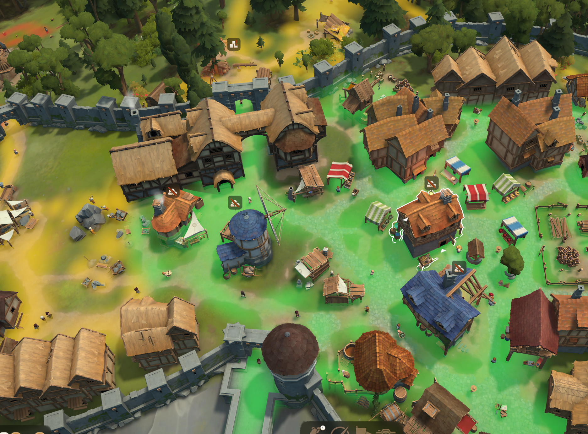

# Distance Heatmap for Foundation

This mod adds a way to view distances from any building based on villager paths. It works by creating a 2m grid of the game map, then sampling agent (villager and visitor) positions every 0.3 seconds to assemble a weighted grid. We then use a simple Dijkstra algorithm to walk from all entrances of any given building and draw the results as fog.

## Usage

To use, simply install and highlight (click) any building to see the map. By default, green is up to 50m from an entrance to the building, yellow is up to 100m, and red is up to 150m. Note that since the mod assembles the map based on where villagers walk, the first time the mod loads into a save it will take several seconds to begin displaying routes. Once the mod has been loaded once, the grid is saved for the future.

Sampled routes decay over time, so unused routes will stop showing at around the same rate as the visual paths begin decaying.

If you wish to select a building without seeing the heatmap, either select a building, then click the ground (this will remove the heatmap without removing the building selection), or disable the mod. There is no in-game toggle at this time.

## Testing

This mod was tested on 25, 200, and 500 population levels, including buildings of 2500+ child objects at no noticeable slowdown.

The repository includes a small fake engine that mimics the game's scripting API. Recommended run with python tests/run_lupa.py from project root.

## Editing the Mod

PathHeatmap/scripts/config.lua contains configuration options. Notable options are:

* BANDS - The distance between close, middle, and far bands. Modify this to increase or decrease the distance between them, or add additional bands. Increasing the maximum distance will decrease performance with the square.
* BAND_COLORS - Modify these RGB values if you would like the bands to be different colors; values run from 0 -> 1. You must have exactly as many colors as bands.
* CELL - The size of the heatmap cells. Decrease for more precise locations at the cost of an exponential decrease in performance. Old cell sizes must decay naturally after CELL size change; the change will not be complete until 14 in-game days after the save is reloaded, and in the meantime will show paths in the wrong scale
